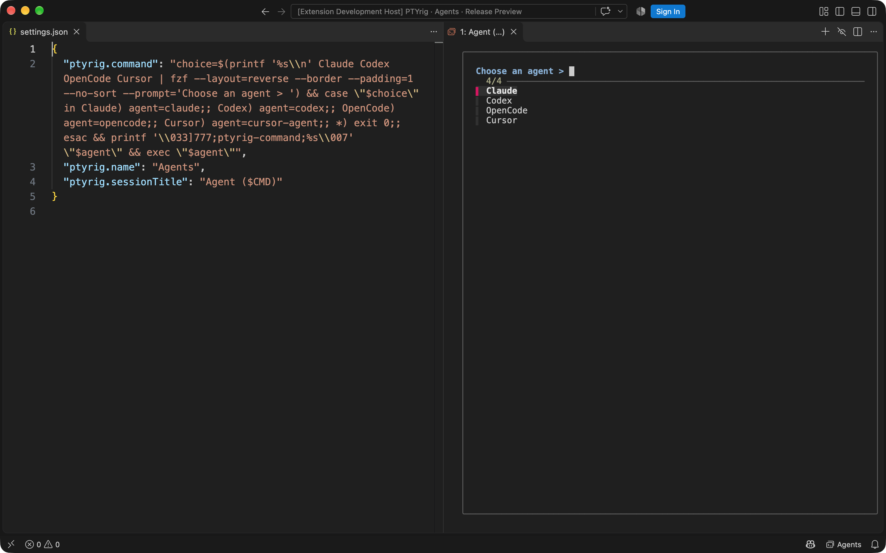
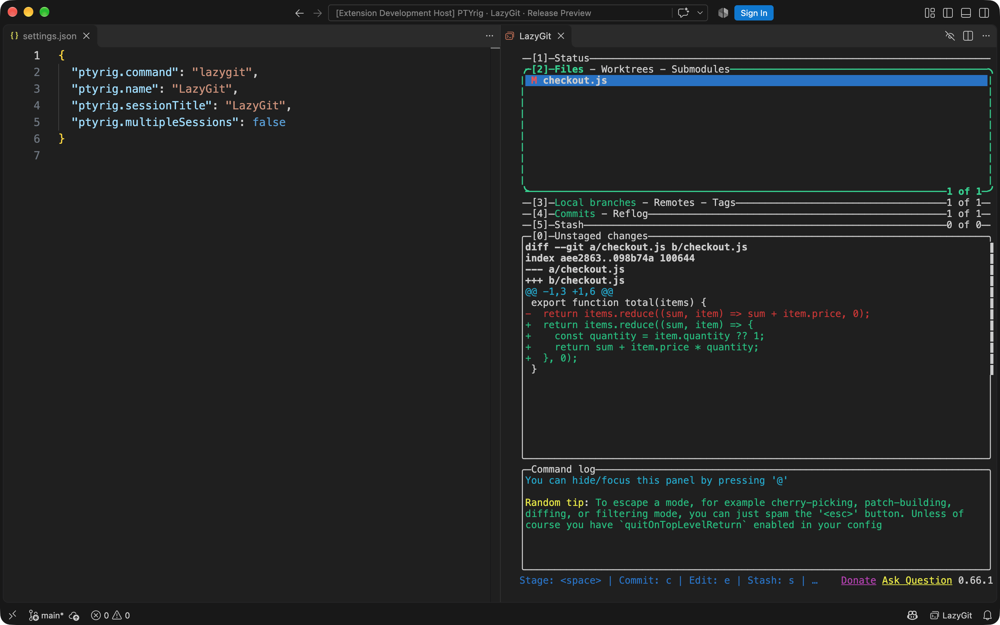

# PTYrig: A terminal harness for VS Code

**Give your CLI/TUI tool a dedicated place in VS Code with a few settings.**

Run Claude Code, Codex, lazygit, or any terminal application in dedicated editor
tabs. Keep sessions running while you hide or show them.

## Install

Available as a **Preview for macOS Apple Silicon**, with VS Code 1.95.3 or newer.
Install from the [VS Code Marketplace](https://marketplace.visualstudio.com/items?itemName=ptyrig.ptyrig)
or run:

```sh
code --install-extension ptyrig.ptyrig
```

Install the terminal tools you want to use separately.

## Configure

Add one of these examples to VS Code's `settings.json`. Install the tools first.
If no command is configured, PTYrig asks you to set one when you first open it.
The status bar launcher appears after startup; click it to start or hide/show sessions.

**Upgrading from 0.1.x:** move your existing session title from `ptyrig.name` to
`ptyrig.sessionTitle`. Use `ptyrig.name` for the launcher label. Both default to `PTYrig`.

### Claude Code

```json
{
  "ptyrig.command": "claude",
  "ptyrig.name": "Claude Code",
  "ptyrig.sessionTitle": "Claude Code"
}
```

Each New Session starts an independent Claude Code process. Tabs appear as
`1: Claude Code`, `2: Claude Code`, and so on.

### Start an agentic coding session



Choose **Claude Code**, **Codex**, **OpenCode**, or **Cursor** to start a coding
session. This example uses a POSIX shell (macOS/Linux) and requires `fzf` plus
the agent commands you intend to select:

```json
{
  "ptyrig.command": "choice=$(printf '%s\\n' Claude Codex OpenCode Cursor | fzf --layout=reverse --border --padding=1 --no-sort --prompt='Choose an agent > ') && case \"$choice\" in Claude) agent=claude;; Codex) agent=codex;; OpenCode) agent=opencode;; Cursor) agent=cursor-agent;; *) exit 0;; esac && printf '\\033]777;ptyrig-command;%s\\007' \"$agent\" && exec \"$agent\"",
  "ptyrig.name": "Agents",
  "ptyrig.sessionTitle": "Agent ($CMD)"
}
```

Select Claude, Codex, OpenCode, or Cursor and press Enter to start coding. Escape
cancels and closes the session. Cursor uses its `cursor-agent` CLI. The launcher reports
its selection before starting it, so tabs become `1: Agent (claude)`,
`2: Agent (codex)`, and so on.

### Review Git changes with Lazygit

Review diffs, stage hunks, and manage commits beside your code. Install `lazygit`
and open a Git repository, then configure:

```json
{
  "ptyrig.command": "lazygit",
  "ptyrig.name": "LazyGit",
  "ptyrig.sessionTitle": "LazyGit",
  "ptyrig.multipleSessions": false
}
```

Click **LazyGit** in the status bar to open Lazygit in a **LazyGit** tab.
Hide/show preserves the running session. With `multipleSessions` disabled,
New Session reveals it instead of starting another process.



## Shortcuts

| Shortcut | Command |
|---|---|
| Ctrl+backslash | PTYrig: Hide/Show |
| Ctrl+Shift+backslash | PTYrig: New Session |

Use Control on macOS too. Change either binding in **Preferences: Open Keyboard
Shortcuts** by searching for `PTYrig`.

Hide/Show keeps your applications running. Closing a session tab stops its
process, and an application exiting closes its tab. Reloading or closing VS Code
stops sessions.

PTYrig uses editor tabs and leaves the bottom terminal panel alone. Commands run
with your user permissions and require Workspace Trust.

## More information

- [Session settings, shortcuts and titles](https://github.com/gunasekar/ptyrig/blob/main/docs/USAGE.md)
- [Development and local builds](https://github.com/gunasekar/ptyrig/blob/main/docs/DEVELOPMENT.md)
- [Architecture and limitations](https://github.com/gunasekar/ptyrig/blob/main/docs/ARCHITECTURE.md)
- [Security](https://github.com/gunasekar/ptyrig/blob/main/SECURITY.md)
- [Contributing](https://github.com/gunasekar/ptyrig/blob/main/CONTRIBUTING.md)
